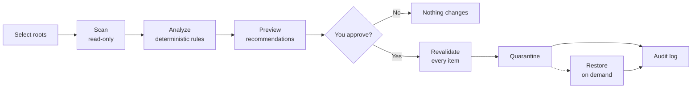

<div align="center">

# 🛡️ SpaceSentry

### Safe Storage Intelligence for Windows

**See what's eating your disk. Reclaim it safely. Undo anything.**


*Built for Next Byte Hacks V5*

</div>

---

## Table of Contents

- [Why SpaceSentry](#why-spacesentry)
- [Features](#features)
- [How It Works](#how-it-works)
- [Safety Model](#safety-model)
- [Project Structure](#project-structure)
- [Getting Started](#getting-started)
- [Running Tests](#running-tests)
- [Configuration](#configuration)
- [Roadmap & Status](#roadmap--status)
- [License](#license)

---

## Why SpaceSentry

Most disk cleaners ask you to trust them: *"Delete these 14 GB?"* SpaceSentry takes the opposite approach. It is built around the idea that **a cleanup tool should be able to prove it is safe**, not just claim it.

- It **explains** what is using your space before suggesting anything.
- It **never deletes permanently by default**. Files go to quarantine and can be restored.
- It **re-checks everything** at the moment of action, not just at scan time.
- It **never leaves your machine**. No cloud, no telemetry.

---

## Features

| | Capability | Details |
|---|---|---|
| 🔍 | **Read-only scanning** | Lists and stats files only. Never opens, moves, renames, or deletes during a scan. |
| 📊 | **Deterministic analysis** | Rule-based categorization, so the same disk always yields the same results. |
| 💡 | **Cleanup recommendations** | Surfaces potentially reclaimable files with the reasoning behind each suggestion. |
| ✅ | **Explicit approval** | Nothing happens until you review and approve specific items. |
| 📦 | **Quarantine, not deletion** | Approved files move to a dedicated quarantine directory with collision-safe naming. |
| ♻️ | **Restoration** | Restore quarantined files to their original location. Existing files are never overwritten. |
| 🧾 | **Audit history** | A record of every cleanup and restore action. |
| 🔒 | **Localhost only** | API binds to `127.0.0.1` with a restricted CORS allowlist. |

---

## How It Works

SpaceSentry follows a strict, staged lifecycle. Every stage is a separate step you control.



1. **Select roots.** You choose which directories may be scanned. Nothing outside them is ever touched.
2. **Scan.** A read-only traversal collects file metadata.
3. **Analyze.** Deterministic rules categorize files and flag potentially reclaimable ones.
4. **Preview.** You see exactly what would be moved and why.
5. **Approve.** You grant explicit, per-item approval using a single-use, short-lived session token.
6. **Revalidate and quarantine.** The backend re-verifies each item, then moves it to quarantine.
7. **Restore (optional).** Put anything back, as long as the original destination is free.

---

## Safety Model

Cleanup never deletes permanently by default. Every guarantee below is enforced by the backend, not the UI.

### Scanning

- **Read-only.** The scanner only lists and stats files.
- **Root-bounded traversal.** Only user-selected directories are scanned.
- **Reparse-safe.** Symlinks and junctions are skipped by default to prevent traversal outside approved boundaries.
- **Loop-safe.** Directory cycles are detected via `(st_dev, st_ino)` identity plus a hard depth limit.

### Cleanup

Before any item is quarantined, the backend revalidates:

| Check | Protects against |
|---|---|
| Canonical path resolution | Path tricks and traversal |
| File identity (`size` + `mtime_ns`) | Files that changed between scan and action |
| Reparse-point status | Links swapped in after the scan |
| Approved-root containment | Actions outside user-selected roots |
| Protected-location rejection | Touching system-critical paths |

Additional guarantees:

- **No auto-deletion.** Every action requires explicit per-item user approval.
- **Single-use, short-lived tokens.** Approval sessions expire and cannot be reused.
- **Collision-safe quarantine.** Files are moved to a dedicated directory with fail-safe collision avoidance.
- **Non-destructive restore.** Restoration refuses to overwrite an existing destination.

### Privacy

- **Localhost only.** The API binds to `127.0.0.1` and uses a restricted CORS allowlist.
- **No data leaves the machine.**

---

## Project Structure

```
SpaceSentry/
├── backend/        FastAPI backend: scanner, analysis, cleanup policy, quarantine
├── frontend/       React + TypeScript + Vite + Tailwind UI
├── tests/          Pytest (backend) and Vitest (frontend)
└── docs/           Categorization rules, architecture, and safety documentation
```

---

## Getting Started

### Prerequisites

- Windows
- Python 3.10+
- Node.js 18+ and npm

### 1. Backend

```bash
cd backend
python -m venv .venv
.venv\Scripts\pip install -r requirements.txt
```

Start the API:

```bash
.venv\Scripts\python -m uvicorn app.main:app --host 127.0.0.1 --port 8765
```

The API is now available at `http://127.0.0.1:8765`. FastAPI's interactive docs are served at `http://127.0.0.1:8765/docs`.

### 2. Frontend

In a second terminal:

```bash
cd frontend
npm install
npm run dev
```

Open the URL printed by Vite in your browser.

### 3. Production build (optional)

```bash
cd frontend
npm run build
```

---

## Running Tests

**Backend** (from the repository root):

```bash
backend\.venv\Scripts\python -m pytest tests/backend -q
```

**Frontend:**

```bash
cd frontend
npm test
```

**Type check:**

```bash
cd frontend
npx tsc --noEmit
```

### Current results

| Suite | Result |
|---|---|
| Backend (pytest) | ✅ 108 passing |
| Frontend (Vitest) | ✅ 16 passing |
| TypeScript compilation | ✅ exits 0 |
| Production build | ✅ succeeds |

The backend suite covers cleanup preview, approval, quarantine, restore, authorization expiry and reuse, collision refusal, and restore conflicts.

---

## Configuration

Backend settings are controlled through environment variables. See [`.env.example`](.env.example) for the full list and defaults.

---

## Roadmap & Status

| Phase | Scope | Status |
|---|---|---|
| 1 | Read-only scanning | ✅ Complete |
| 2 | Deterministic analysis and categorization | ✅ Complete |
| 3 | React + TypeScript frontend | ✅ Complete |
| 4 | Safe cleanup, quarantine, restoration, audit history | ✅ Complete |

---

## License

Hackathon project for **Next Byte Hacks V5**.


## Author

Andhony Saviyar

GitHub: @andhony07


SpaceSentry — Make storage decisions with visibility, evidence, and control.